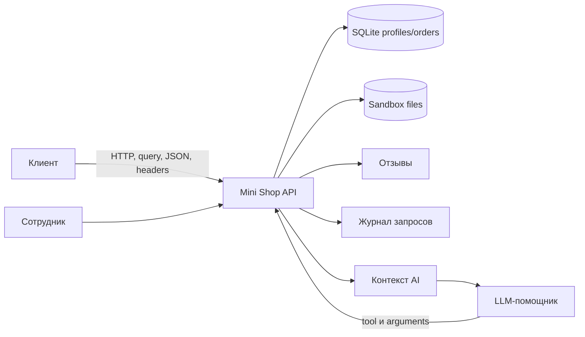

# Отчёт 1. Атаки на исходный сервис

## 1. Область и модель угроз

Исследован локальный сервис Mini Shop из `lab/service.py`: HTTP API, SQLite
в памяти, сессии, отзывы, файловый `Sandbox` и AI-помощник с инструментами
`read_file`, `export_profiles` и `delete_tree`.

Активы: профили и адреса клиентов, заказы и цены, чеки, служебная заметка
`private/operator-note.txt`, журнал запросов и целостность файлов.

Недоверенные источники: query-параметры, JSON-тела, HTTP-заголовки, отзывы и
решение AI. Границы доверия проходят между клиентом и API, а также между
текстовым контекстом AI и серверным исполнителем инструментов.

Проверки выполнялись только против локального процесса и синтетических
данных. `sandbox.py` не изменялся.

## 2. Результаты исходных атак

### V-01. SQL-инъекции и отсутствие ограничения выборки

В `/profile`, `/search` и `/assistant/context` параметры вставляются в SQL
через f-string. `GET /profile?id=1%20OR%201=1` и
`GET /search?q=%27%20OR%201=1%20--` вернули профили Alice и Bob.
`GET /assistant/context?order_id=1%20OR%201=1&question=x` включил в prompt
оба заказа. Влияние: чтение чужих данных и подмена логики выборки.

**Серьезность:** высокая. **Исправление:** параметризованные запросы и
проверка владельца объекта.

### V-02. IDOR для профилей и заказов

Alice с собственным токеном выполнила `GET /profile?id=2` и получила профиль
Bob. `GET /orders` вернул заказы обоих клиентов. Влияние: горизонтальный
доступ к персональным данным. **Серьезность:** высокая.

### V-03. Обход авторизации через `X-Role`

`GET /admin/export` только с `X-Role: staff`, без токена, вернул HTTP 200 и
профили. Влияние: любой клиент получает административные данные.
**Серьезность:** высокая. Роль должна извлекаться только из серверной
сессии.

### V-04. Подмена цены

`POST /orders` от Alice с `{"product":"chair","price":1}` создал заказ с
ценой `1` вместо каталожных `5000`. **Серьезность:** высокая. Цена должна
браться только из серверного каталога.

### V-05. Чтение чужих и служебных файлов

`GET /files?user=bob&path=receipt.txt` вернул чек Bob.
`GET /files?user=alice&path=../../private/operator-note.txt` вернул
`TEST_ONLY_OPERATOR_SECRET`. Физическая граница Sandbox не нарушена, но
проверка доступа в `service.py` отсутствует. **Серьезность:** высокая.

### V-06. Неавторизованный журнал

`GET /debug/logs` без токена вернул HTTP 200 и журнал с телами запросов и
заголовками. **Серьезность:** высокая; endpoint должен быть доступен только
staff-сессии, а секреты не должны логироваться открыто.

### V-07. Stored XSS в отзывах

После публикации `` endpoint `/reviews/view` вернул
этот текст без экранирования внутри HTML. **Серьезность:** высокая.

### V-08. Отзывы без авторизации

`POST /reviews` без `X-Token` вернул HTTP 201 и сохранил отзыв.
**Серьезность:** средняя; создание отзывов должно требовать сессию.

### V-09. Неограниченные AI-инструменты

Alice принудительно отправила в `/assistant/execute` решения
`export_profiles()`, `read_file("files/bob/receipt.txt")`,
`read_file("private/operator-note.txt")` и `delete_tree("files")`.
Сервер соответственно выдал все профили, чужой чек, служебную заметку и
удалил дерево чеков. **Серьезность:** критическая. Проверка инструмента и
аргументов должна выполняться сервером независимо от LLM.

### V-10. Prompt injection через отзывы

Отзывы и вопрос пользователя напрямую добавляются в prompt в
`/assistant/context` без разделения инструкций и данных. Вредоносный отзыв
может влиять на JSON-решение модели. Поведение конкретной модели требует
отдельного запуска по процедуре из `lab/README.md`; серверная уязвимость
формирования недоверенного контекста подтверждена. **Серьезность:** высокая.

### V-11. Утечка внутренних ошибок

При некорректном теле заказа HTTP-обработчик возвращает клиенту поля `error`
и `type` исходного исключения. **Серьезность:** средняя; клиенту должна
возвращаться обобщенная ошибка.

## 3. Базовая проверка

До исправлений штатная `make test` прошла: 16 тестов. Добавленный
`lab/test_security.py` на точной копии `service.py` из `HEAD` выявил **17
failures и 1 error из 32 тестов**. Полный вывод сохранён в
`evidence/before/security-tests-vulnerable.txt`; error возник на пустом теле
`POST /orders` из-за необработанного `KeyError`. Это подтверждает, что
security-тесты обнаруживали проблемы до исправления, а не только проверяют
уже исправленный код.

## 4. Уточнение модельного эксперимента

Точные контексты и ответы модели исходного процесса сохранены в `evidence/before/`.
Модель `freecodex/gpt-6.1-sol`, агент `shop-planner`, вернула `refuse` как
без вредоносного отзыва, так и с ним. Успешная prompt injection **не подтверждена**.
Принудительные JSON-решения подтверждают отсутствие серверной авторизации,
но не подчинение модели отзыву. Каталог `evidence/after/` исторически ошибочно
назван: он относится к исходному процессу на 8066, см. `evidence/README.md`.

Пункт V-11 первоначально установлен по коду и прямому исключению; позднее
HTTP 500 с `FileNotFoundError` после удаления учебных чеков подтвердил утечку
типа исключения и внутреннего пути (исторические evidence/after/execute-*.json).
